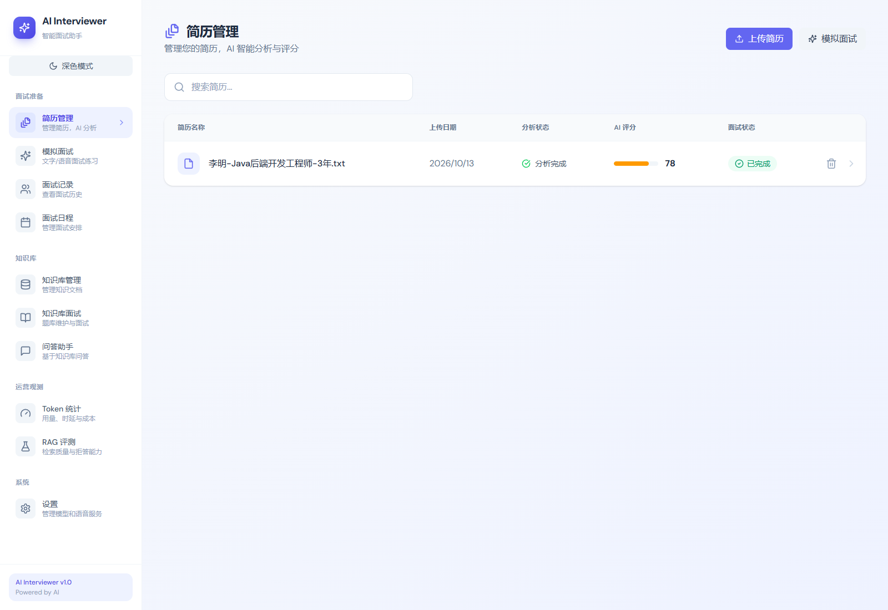
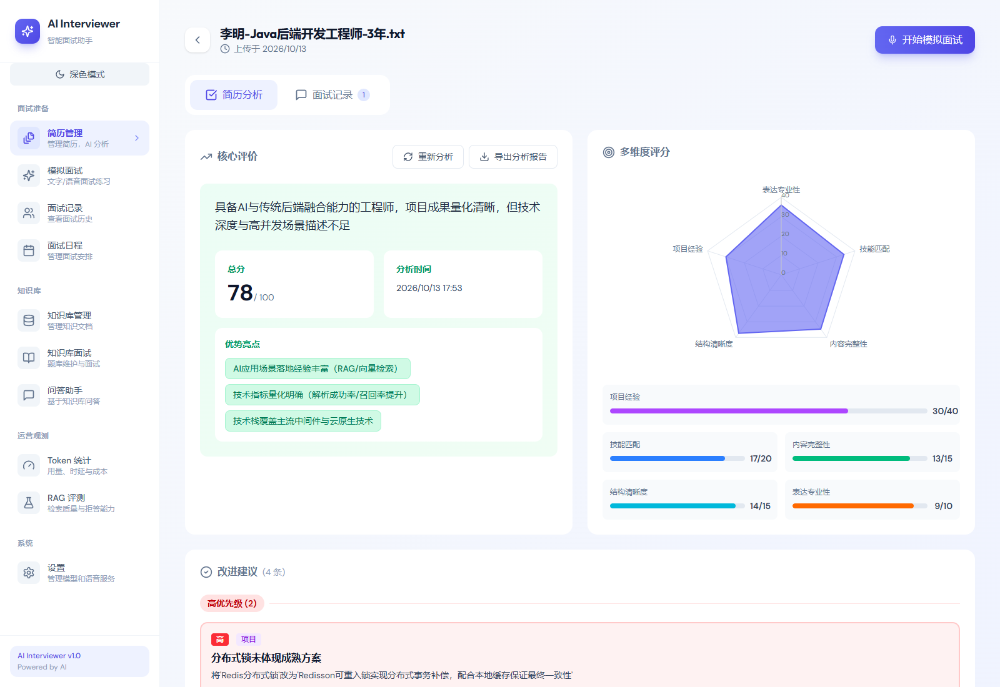
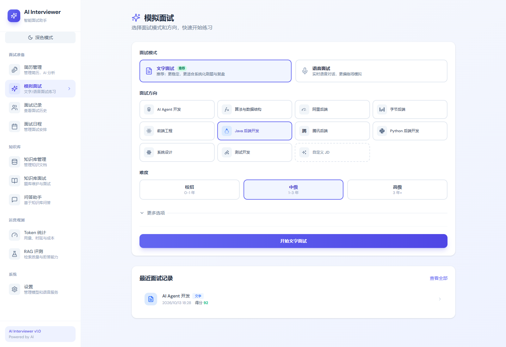
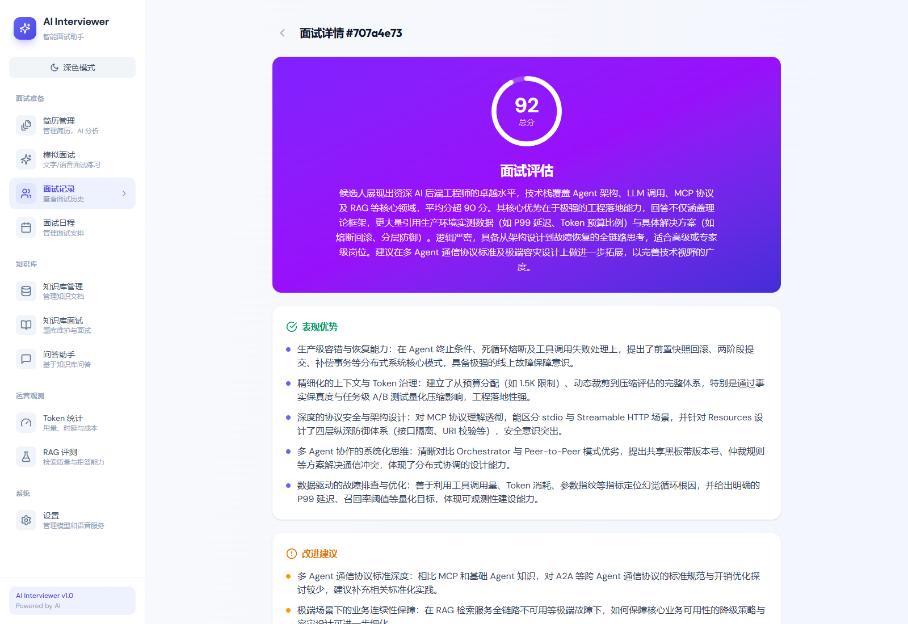
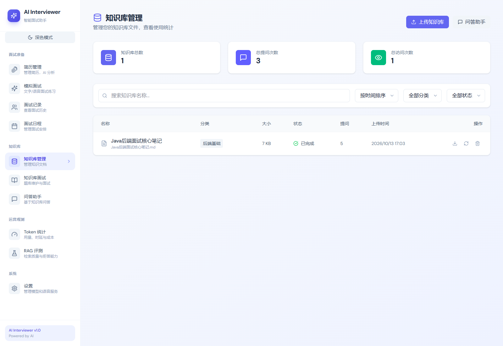
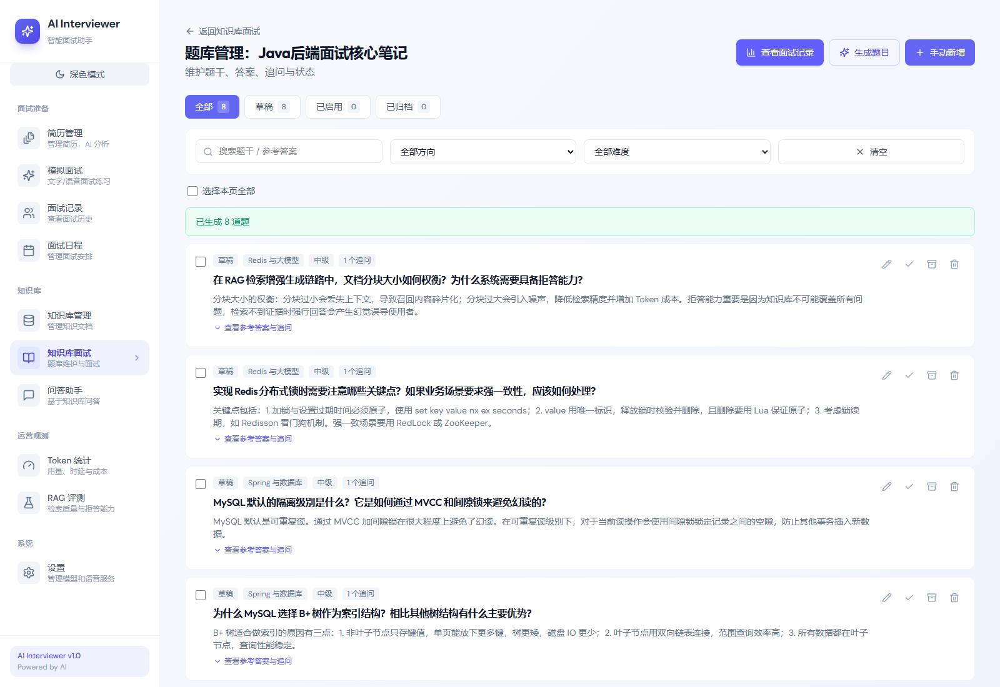
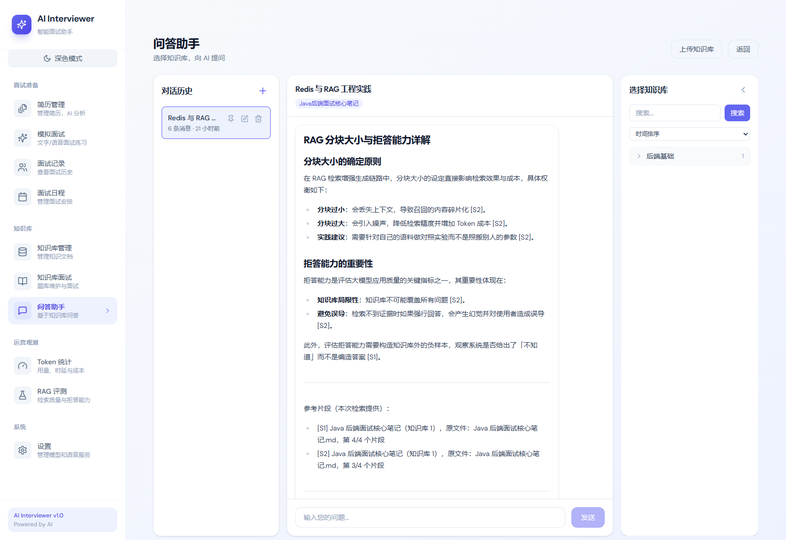
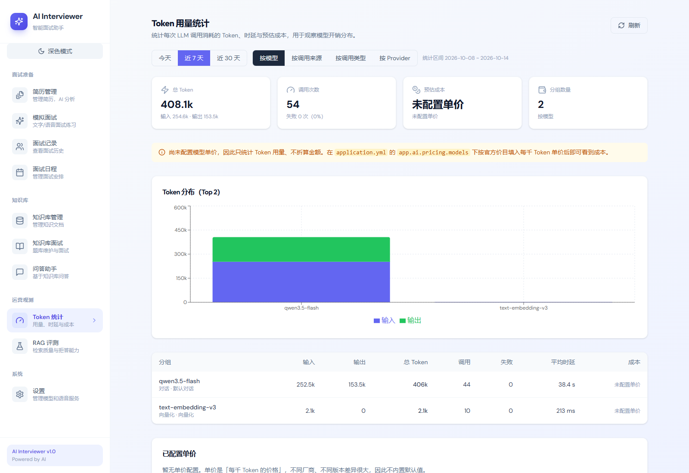
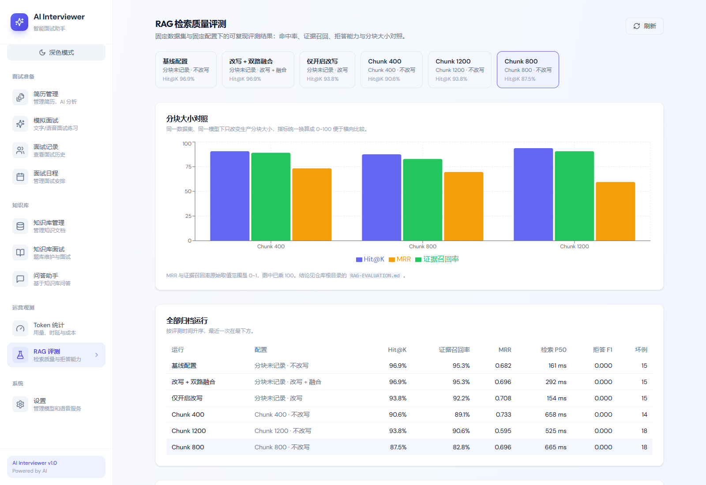

# AI Interviewer

一个本地部署的面试练习平台：传简历、出面试题、语音对练、生成报告，知识库里的资料可以检索着回答。

Spring Boot 4.1 / Java 25 / Spring AI 2.0 + React 18。全程 Docker 起依赖，除了大模型 API Key 不需要外部服务。

## 界面

| 简历列表 | 简历详情 | 面试入口 |
| --- | --- | --- |
|  |  |  |

| 面试报告 | 知识库 | 题库面试 |
| --- | --- | --- |
|  |  |  |

| 知识库问答 | Token 用量 | RAG 评测 |
| --- | --- | --- |
|  |  |  |

## 做什么

- **简历**：上传 PDF / Word / Markdown，Tika 抽文本，异步交给大模型拆成结构化的技能、项目、亮点；可以就地编辑，导出 PDF。
- **文字面试**：按简历和目标岗位生成题目，一问一答，答完出评分报告（维度分数、参考答案、改进建议）。
- **语音面试**：WebSocket 传音频，实时 ASR → 大模型 → 流式 TTS，中间有回声抑制、暂停续聊、逐句字幕。
- **知识库**：上传文档切片入库，pgvector 检索（1024 维，余弦距离），带来源片段作答；也能从知识库里出题做专项练习。
- **周边**：每次模型调用的 token 与花费统计、RAG 检索质量评测。

## 技术选型

| 层 | 选型 | 说明 |
| --- | --- | --- |
| 后端 | Spring Boot 4.1.0、Java 25、Gradle | 虚拟线程跑语音管线 |
| AI | Spring AI 2.0.0、DashScope（百炼） | 聊天走 `ChatClient`，结构化输出统一收口 |
| 数据 | PostgreSQL + pgvector、Flyway、JPA | 向量 1024 维 / COSINE；12 个迁移脚本，`ddl-auto: validate` |
| 缓存与异步 | Redis、Redisson、Redis Stream | 限流（Lua 脚本）、任务队列、会话缓存 |
| 存储与解析 | RustFS（S3 协议）、Apache Tika | 文件与内容识别 |
| 前端 | React 18、TypeScript、Vite、Tailwind 4 | React Router 7，手写 SSE / WebSocket 客户端 |
| 其它 | MapStruct、iText 8、SpringDoc、Playwright | 映射、导出、接口文档、E2E |

## 快速开始

需要 JDK 25、Node 20+、pnpm、Docker。

```bash
git clone <repo> && cd AI-interviewer

# 仓库自带 commit message 校验，但 git 不会自动读 .githooks，指一次
git config core.hooksPath .githooks

cp .env.example .env
# 编辑 .env：AI_BAILIAN_API_KEY 必填，APP_AI_CONFIG_ENCRYPTION_KEY 随便一串长随机
# 模型等其他配置可在启动后的设置页里改

docker compose -f docker-compose.dev.yml up -d    # PostgreSQL / Redis / MinIO
./gradlew :app:bootRun                            # 后端 :8080
cd frontend && pnpm install && pnpm run dev       # 前端 :5173
```

想直接跑整套（含 Nginx 反代）：`docker compose up -d --build`，然后访问 `http://localhost:8000`。

环境变量说明见 [SETUP_API_KEYS.md](SETUP_API_KEYS.md)，起不来先看 [docs/troubleshooting.md](docs/troubleshooting.md)。

## 目录

```
app/src/main/java/ai/interviewer/
  common/          限流、AI 调用封装、异步模板、异常与统一响应
  infrastructure/  文件存储、导出、Redis、S3、映射
  modules/         业务模块，每个模块自带 Controller/Service/Repository
    resume/ interview/ voiceinterview/ knowledgebase/ rageval/ tokenusage/ llmprovider/
app/src/main/resources/
  prompts/         StringTemplate 提示词模板
  db/migration/    Flyway 迁移
frontend/src/      pages / components / api / hooks / types
docs/              ADR、架构说明、排错
```

## 开发

```bash
./gradlew :app:test --no-daemon        # 单元 + 集成测试
./gradlew :app:spotlessCheck           # 代码格式
cd frontend && pnpm run lint           # ESLint
cd frontend && pnpm run test:unit      # 前端单测
cd frontend && pnpm run build          # 类型检查 + 构建
```

推送到 `main` 或提 PR 时 CI 会跑同一组检查：后端 spotless + 测试，前端 lint + 格式 + 单测 + 构建 + 两个 E2E。当前 560 个用例、128 个测试套件，其中 15 个需要真实 Redis / PostgreSQL，没有环境时跳过。

RAG 检索质量的实测数据、分块与改写对照在 [RAG-EVALUATION.md](RAG-EVALUATION.md)，那是一次性快照，不是调参结论。

## 近期改动

按时间倒序。每条都是一个独立 commit，决策写进 `docs/adr/`。

- **把语音面试的 WebSocket handler 拆开**：从 1463 行拆到 1006 行，先后抽出 WAV 编码、出站消息、分句 TTS 管线、连接状态、暂停监控五个类，每抽一个补一组单测。
- **删掉面试日程模块**：28 个文件、2600 行，没有测试，README 和 docs 里一次没提过，跟主线的简历/面试/知识库也没有数据往来。[ADR-0002](docs/adr/0002-drop-interview-schedule.md)
- **数据层三个修**：会话列表原来在循环里逐条 count 消息（N+1）；会话缓存和评估任务在事务提交前就写了，回滚会留下幽灵会话；语音面试三张表从建库起没有索引。[V20261024](app/src/main/resources/db/migration/V20261024__add_voice_session_indexes.sql)
- **三个安全问题**：上传校验里扩展名能顶替 MIME 类型（改个后缀就能进知识库）；限流身份读客户端自己写的 `X-User-Id`，换值即换桶；ASR 连通性测试对任意 host:port 建 TCP 连接，等于端口扫描器。
- **删掉三个整体 @Disabled 的测试类**：866 行、约 40 个用例，从加 `@Disabled` 那天起没跑过，却一直算在测试统计里。[ADR-0001](docs/adr/0001-drop-disabled-voice-tests.md)

## 已知限制

- **没有用户体系**：单用户部署，没有权限隔离。38 处 `@RateLimit` 是按连接地址的限流，不是认证。
- **RAG 不会拒答**：检索不到证据时仍然让模型硬答，评测里拒答召回率为 0，见 [RAG-EVALUATION.md](RAG-EVALUATION.md)。
- **语音延迟偏高**：服务端中转音频，弱网下会断续。上 WebRTC 能改善，但那是另一个量级的改造。
- **评测样本小**：40 条样本、单配置单次运行，只能用来定位问题。
- **设置页的 YAML 编辑器是手写的**：`YamlTextEditor` 只认本项目自己写的那几个键，换缩进或加注释会丢内容。暂时不修，理由是它只服务于一个低频的兜底路径；触发条件记在 ADR 里。

## 来源与许可

基于 [Snailclimb/interview-guide](https://github.com/Snailclimb/interview-guide) 二次开发，原作者 Snailclimb 允许个人使用。在此基础上做了品牌与工程重构、RAG 评测、Token 成本统计。

本项目采用 [AGPL-3.0](LICENSE)：通过网络提供服务就必须公开修改后的源码。
